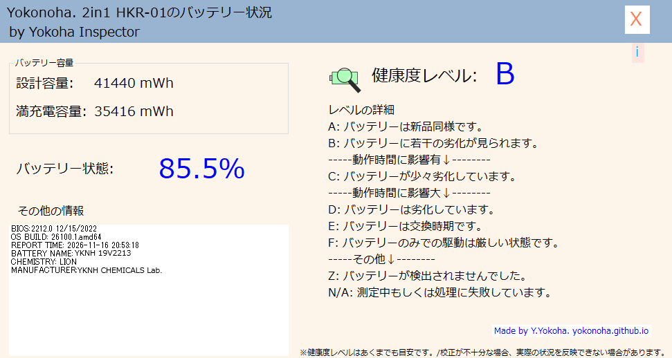

# Yokoha Inspector

**ノートPC向けバッテリー健康度判定ツール**

ノートPCのバッテリー劣化具合を、A～Fの6段階でわかりやすく判定する軽量ユーティリティです。

## 概要

Yokoha Inspector は、Windows標準搭載の `powercfg.exe` が生成するバッテリーレポートを利用し、ノートPCのバッテリー健康度を自動で判定するソフトウェアです。

バッテリーの設計容量（Design Capacity）と満充電容量（Full Charge Capacity）などの情報を取得し、その劣化具合を独自の基準で評価します。

難しいコマンド操作や専門知識は必要ありません。ソフトウェアを起動するだけで、現在のバッテリー状態を簡単に確認できます。

## 主な特徴

- **A～Fの6段階評価**：バッテリーの健康度を直感的に把握できます。
- **自動測定**：`powercfg.exe` のバッテリーレポートを参照して必要な情報を取得します。
- **インストール不要**：実行ファイル（EXE）単体で利用できます。
- **持ち運び可能**：USBメモリなどに入れて、複数のPCで使用できます。
- **中古PCの検品にも便利**：中古ノートPCやジャンクPCの状態確認にも活用できます。

## 動作環境

| 項目 | 要件 |
|---|---|
| アーキテクチャ | 64bit |
| 配布形式 | exeファイル |
| インストール | 不要 |

※ 実行環境によっては、必要なランタイムのインストールを求められる場合があります。その場合は画面の指示に従ってセットアップしてください。  
※また、本ソフトウェアは自己署名のため、初回利用時にスマートアプリコントロールやUAC(ユーザーアカウント制御)により警告表示・利用中断をされる可能性がございますが、その場合は警告を一時的に解除してお使いください。(お手数をおかけいたします)  
[[参考] VirusTotalによるウイルスチェック結果 (Rev.1:異常なし)](https://www.virustotal.com/gui/file/1265dc2b38e87aa6a19e7cd3f09f2806fecd77f38c48aad3dc010b718389f444/detection)
## 健康度ランクについて

本ソフトウェアでは、バッテリーの状態を以下のランクに分類します。

| ランク | 判定 | 説明 |
|:---:|---|---|
| **A** | 新品同様 | ほとんど劣化が見られない状態 |
| **B** | 良好 | 若干の劣化はあるものの、常用に問題のない状態 |
| **C** | 少々劣化 | 劣化が見られ、バッテリーの持ちが気になり始める状態 |
| **D** | 劣化進行 | 新品時と比べて駆動時間が明らかに短くなっている状態 |
| **E** | 交換時期 | 新品時の半分以下の容量しか残っていない状態 |
| **F** | 動作厳しい | バッテリーの蓄電能力が著しく低下している状態 |
| **Z** | 未装着・異常 | バッテリーが未装着、または正常に認識されていない状態 |
| **N/A** | 測定中・失敗 | 測定処理中、またはレポートの取得・解析に失敗した状態 |

### 「不正確」の表示について

バッテリーの設計容量を満充電容量が上回っている場合など、取得した数値に不自然な点があると判断された場合、ランクに「（不正確）」と表示されることがあります。

これはバッテリー内部の残量計の校正ずれなどによって発生する場合があります。

## 使い方

1. 配布ページから `YKHInspector.exe` をダウンロードします。
2. ダウンロードした実行ファイルを起動します。
3. ソフトウェアによるバッテリー情報の取得・解析を待ちます。
4. 表示された健康度ランクを確認します。

特別な設定やインストール作業は基本的に必要ありません。

## 注意事項・免責事項

### 判定結果について

本ソフトウェアが表示する健康度ランクは、開発者が独自に設定した基準に基づく参考値です。

メーカー公式の診断結果ではなく、実際のバッテリー駆動時間や今後の寿命を保証するものではありません。

### バッテリーの校正について

バッテリー内部の残量計の校正が不十分な場合、実際の状態と異なる数値が取得されることがあります。

測定結果に疑問がある場合は、バッテリーの状態やメーカー提供の診断ツールなども併せて確認してください。

### 免責事項

本ソフトウェアの利用によって発生したいかなる損害、データ損失、不具合等についても、開発者は責任を負いません。

本ソフトウェアは利用者自身の責任においてご利用ください。

また、本ソフトウェアをダウンロードもしくはご利用になられた時点で[開発者の利用規約](https://yokonoha.github.io/readme)に同意したものとみなします。利用規約はソフトウェアのInfoボタン(iのマーク)からもご覧いただけます。  

## ダウンロード

最新版および詳細情報は、以下の公式ページをご確認ください。

**[Yokoha Inspector 公式ページ](https://yokonoha.github.io/yokohainspector/)**

## ライセンス

透明性確保の観点から、本ソフトウェアはMITライセンスの適用されたオープンソースソフトウェアとして公開しています。

ライセンス条件および再配布・改変に関する取り扱いについては、リポジトリ内のライセンス文書をご確認ください。

## 開発者

**横茶横葉 (Y.Yokoha)**

© 2026 Y.Yokoha All Rights Reserved.  

## 他バージョンに関して  

開発者が許可・紹介するYokoha Inspectorの他バージョン・エディション(Hokari Inspectorなど)はクローズドソースですが、内部的には本ソフトウェアを利用したものであり、UI以外の改変は行われていないことを確認しています。  

